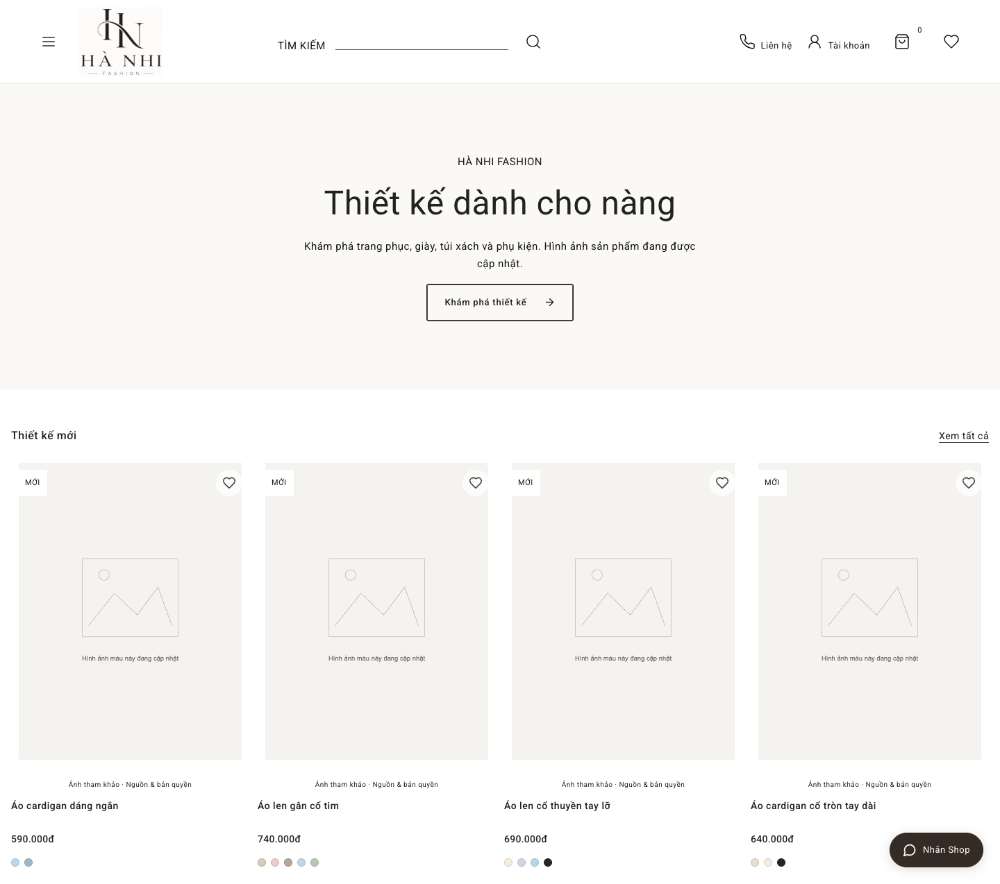
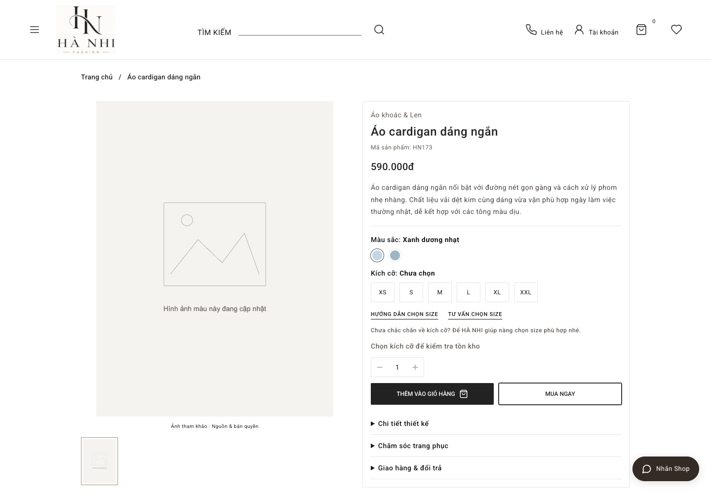
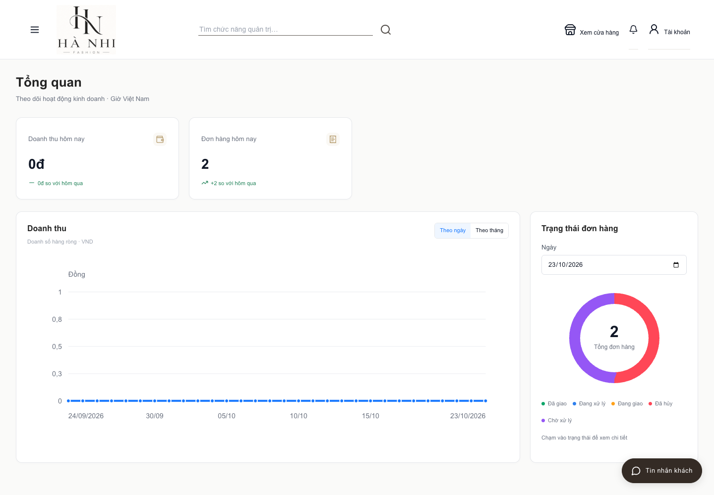
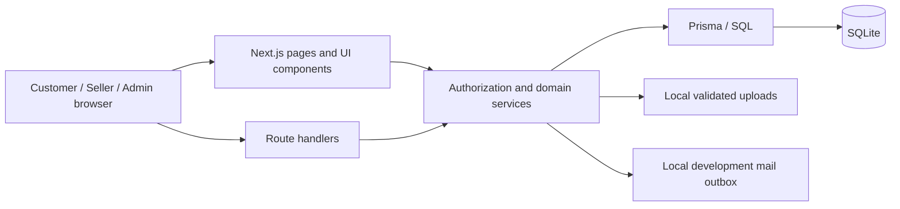

# HÀ NHI FASHION

**Languages:** **English** | [Tiếng Việt](README.vi.md)

A local-first fashion commerce application and business-analysis case study covering the customer purchase journey, store operations, inventory control, returns, and financial reconciliation.

The project connects **business requirements, role permissions, state transitions, data constraints, implementation, and executable verification**. It is intended for a BA/IT portfolio and hands-on evaluation—not as a claim of production deployment or real payment processing.

## Business problems

- **Overselling and inconsistent stock:** concurrent checkout, cancellation, receipt, and return operations must update inventory atomically and exactly once.
- **Unclear operational responsibility:** customers, store employees, and administrators need different capabilities, enforced at both the UI and service/API boundaries.
- **Delivery status confused with payment status:** a delivered parcel does not automatically prove collection or remittance of COD funds.
- **Returns affecting sellable stock incorrectly:** defective or damaged items must not re-enter sellable inventory without the appropriate inspection.
- **Unreliable management figures:** sales, refunds, discounts, cost coverage, and profit need explicit definitions based on preserved order snapshots and ledger records.
- **Inconsistent product information:** color-specific images, sizes, variants, pricing, and publication readiness need consistent ownership and validation.

## Product scope

| Area | Implemented capabilities |
| --- | --- |
| Customer storefront | Categories and collections, search/filter/sort, product variants, color-specific galleries, size guidance, wishlist, cart, vouchers, and checkout. |
| Customer account | Profile and addresses, owned order history, order tracking, verified-purchase reviews, support, and defect-return requests. |
| Store operations | Catalog and media management, variant/SKU inventory, stock movements, stocktakes, order assignment, packing, manual shipment tracking, and customer support. |
| Finance | COD collection, remittance and reconciliation; approved simulated refunds; cost history and profit reporting with missing-cost coverage disclosed. |
| Administration | Three-role access control, account and staff management, store configuration, promotions, and operation/audit history. |
| Reporting and localization | Filtered operational reports and CSV/XLSX exports; Vietnamese/English preferences and display currencies, with transaction ledgers kept in VND. |

### Roles

| Role | Responsibility | Important boundary |
| --- | --- | --- |
| **CUSTOMER** | Shop and manage their own profile, addresses, orders, reviews, support, and return requests. | Cannot access another customer's records or staff operations. |
| **SELLER** | Operate catalog, inventory, orders, manual shipping, and customer support within the permission matrix. | No account administration, financial reconciliation, refund approval/execution, or profit/cost administration. |
| **ADMIN** | Administer the application, staff, finance, reconciliation, and business configuration. | Protected administrator invariants and state/ownership checks still apply. |

The [role-permission matrix](docs/rbac-role-permission-matrix.md) is the detailed contract. Hiding a menu is not an authorization control; API handlers and business services check permissions independently.

### Deliberate boundaries

- The application runs locally. Shipping is recorded manually; payment, COD, and refund operations do **not** transfer money or contact a live carrier/bank.
- Defect returns use the documented **72-hour** window. Preference-based size/color exchanges, partial cancellation, and unequal-price exchanges are not silently enabled without an approved business policy.
- Sample merchandise, quantities, and financial records are fictional. Reference photographs are not evidence that the store supplies those goods or holds redistribution rights.
- This repository does not claim production security certification, accessibility certification, load-test capacity, or commercial readiness.
- Authentication rate limits are in-process. Any exposure beyond local development requires a trusted reverse proxy that replaces client-supplied forwarding headers; distributed rate limiting and deployment hardening are outside this local demonstration.

## Screenshots

The images below are captured from the isolated, fictional portfolio dataset. Missing product photographs are shown honestly rather than replaced with AI-generated merchandise or uncleared brand photography.

### Customer storefront



### Product selection



### Store administration



## Technology stack

| Layer | Technology and purpose |
| --- | --- |
| Application | Next.js App Router, React, TypeScript; server-rendered pages and route handlers. |
| Data | Prisma with SQLite; migrations, relational constraints, transactional business operations. |
| Validation and authentication | Zod, bcrypt password hashing, server-side sessions, permission and ownership checks. |
| UI | CSS/Tailwind, Lucide icons, local fonts, responsive layouts, and accessible native controls/dialogs. |
| Reporting | SQL/Prisma aggregation and ExcelJS streaming XLSX generation. |
| Verification | Vitest, Playwright, business API scenarios, ESLint, TypeScript, and production builds. |
| Tooling | Node.js 22.12+; pnpm 10.34.7 pinned through `packageManager`. |

## Architecture



**Business boundaries:** identity/permissions; catalog/pricing; cart/checkout; order/stock lifecycle; shipping/COD; returns/refunds; customer support; analytics. State-changing operations preserve snapshots, validate transitions, and record the appropriate operational history.

```text
src/app/          Pages, route handlers, shared layout and styles
src/components/   Customer and staff interfaces
src/lib/          Domain services, permissions, validation and queries
prisma/           Relational schema, migrations and safe seed
scripts/          Local setup, operations and executable business scenarios
tests/           Unit, browser and acceptance tests
docs/             BA artifacts, rules, data model and diagrams
```

## Run the safe demo

### Prerequisites

- Node.js **22.12 or later**; Node.js 24 is used by CI.
- pnpm **10.34.7**. Use Corepack if available, or prefix commands with `npx --yes pnpm@10.34.7` when pnpm is not installed.
- Python 3 for the existing SQLite backup/business utilities.

```sh
pnpm install --frozen-lockfile
pnpm db:generate
pnpm demo:setup portfolio
pnpm demo:dev portfolio
```

Open **[http://localhost:3000/](http://localhost:3000/)** for the storefront. Staff access starts at `/dang-nhap`; navigation after login follows the account role.

The setup command creates a **new, isolated** workspace under `.local-demo/portfolio/`, with a separate SQLite database and randomly generated credentials for CUSTOMER, SELLER, and ADMIN. Credential material remains local and ignored by Git. Existing workspaces are refused instead of reset or overwritten. The launcher selects this database explicitly; it does not replace your existing `.env` or `prisma/dev.db`.

```sh
# A second independent dataset; no reset of the first workspace.
pnpm demo:setup another-demo
DEMO_PORT=3002 pnpm demo:dev another-demo

# Use the production build locally with the same isolated dataset.
pnpm build
DEMO_SERVER=production pnpm demo:dev portfolio
```

### Existing local installations

Keep existing databases, credentials, uploads, and `.env` private. Back up the database before applying migrations. Configure your own `DATABASE_URL` using `.env.example`, then use `pnpm db:migrate` and `pnpm dev`; do not reset the main database or run destructive seed commands over it.

The safe demo is the recommended portfolio entry point. The original local store dataset and restricted reference-photo library are **not** required to evaluate the application.

## BA documentation

Start with [the current product specification](PROJECT_SPEC.md), then follow the business rules and executable acceptance contracts:

- [Business requirements and stakeholder scope (BRD)](docs/business-requirements.md)
- [Use cases, alternate paths, and postconditions](docs/use-cases.md)
- [End-to-end process flows](docs/business-processes.md)
- [Business-rule catalog](docs/business-rules.md)
- [Logical data model and ERD](docs/data-model.md)
- [Traceable test scenarios](docs/test-scenarios.md)
- [Roles and permissions](docs/rbac-role-permission-matrix.md)
- [Order lifecycle and business rules](docs/order-business-rules.md)
- [Shipping](docs/shipping-business-rules.md) and [COD reconciliation](docs/cod-reconciliation.md)
- [Defect returns and refunds](docs/returns-business-rules.md)
- [Analytics definitions](docs/analytics-metric-definitions.md) and [profit rules](docs/profit-calculation-rules.md)
- [Acceptance scenarios](docs/business-acceptance-31.md)
- [Schema-derived ERD](docs/diagrams/sql-relationships.mmd) and [readable SQL map](docs/diagrams/sql-relationships.png)

The documentation distinguishes current behavior from business-policy exclusions. Historical verification files are not substitutes for running the current code.

## Verification

```sh
pnpm lint
pnpm typecheck
pnpm test
pnpm build
pnpm test:critical
pnpm exec playwright install chromium
pnpm test:e2e
pnpm test:uat
pnpm audit --audit-level=moderate
```

`test:critical` runs order, shipping, return, authorization, catalog, analytics, and business-acceptance scenarios against a newly migrated test database, reusing the production build. `test:e2e` provisions its own isolated browser-test database. `test:uat` creates a separate empty, migrated database for role management, responsive screens, and the complete purchase-to-refund journey. No suite copies or resets the main store database.

The [GitHub Actions workflow](.github/workflows/ci.yml) runs the same quality gates, including a dependency audit. Its presence describes automation; a successful remote run is not claimed before the workflow actually runs on GitHub.

## Contribution scope represented in this repository

- **Business analysis:** domain and stakeholder modeling, use-case and exception analysis, role responsibilities, state-transition rules, financial definitions, and acceptance criteria.
- **Data and application engineering:** relational modeling, migrations, transactional stock/order workflows, service-level permissions, preserved order snapshots, and operational ledgers.
- **Frontend integration:** responsive customer/staff interfaces, product and variant selection, validation feedback, and role-aware operational actions.
- **Quality and security:** isolated demonstration/test data, boundary and workflow tests, repository exclusions, dependency remediation, and repeatable CI commands.

These contributions are evidenced by the linked documents, source, migrations, and executable scenarios. This is not a claim of sole authorship of third-party libraries/assets, or of a commercial deployment.

## Repository safety and asset rights

- Secrets, private databases, backups, local credentials, uploads, mail output, and verification artifacts stay outside the published source tree.
- The demo uses reserved/fictional identities and generated passwords. Do not paste local credentials into issues, screenshots, commits, or logs.
- Restricted local reference photographs are excluded without deleting the owner's working files. Do not re-add them simply to make the demo more visually complete.
- Source attribution is retained in [THIRD_PARTY_IMAGES.md](THIRD_PARTY_IMAGES.md). Attribution is **not** permission to redistribute images, brand marks, or likenesses. Project branding is retained separately and carries no blanket asset license.
- Existing Git history may still contain previously tracked restricted images. Do not publish that history without resolving redistribution rights or approving a separate sanitized publication/history strategy.

No push, deployment, or history rewrite is performed by the local setup or verification workflow.
