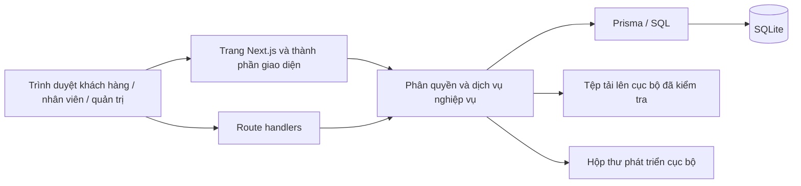

# HÀ NHI FASHION

**Ngôn ngữ:** [English](README.md) | **Tiếng Việt**

Ứng dụng thương mại điện tử thời trang vận hành cục bộ, đồng thời là nghiên cứu tình huống phân tích nghiệp vụ: từ hành trình mua hàng đến vận hành cửa hàng, kiểm soát tồn kho, đổi trả và đối soát tài chính.

Dự án kết nối **yêu cầu nghiệp vụ, phân quyền, chuyển trạng thái, ràng buộc dữ liệu, triển khai phần mềm và kiểm thử thực thi**. Sản phẩm phục vụ portfolio BA/IT và trải nghiệm đánh giá trực tiếp; không đại diện cho hệ thống đã triển khai thương mại hoặc xử lý thanh toán thật.

## Bài toán nghiệp vụ

- **Bán vượt tồn và sai lệch số lượng:** đặt hàng, hủy đơn, nhập kho và nhận hàng trả phải cập nhật tồn kho trong giao dịch, đúng một lần ngay cả khi có thao tác đồng thời.
- **Trách nhiệm vận hành chưa rõ ràng:** khách hàng, nhân viên và quản trị viên cần có phạm vi quyền riêng, được kiểm soát ở cả giao diện lẫn API và dịch vụ nghiệp vụ.
- **Nhầm lẫn giữa giao hàng và thanh toán:** giao thành công không đồng nghĩa đã thu tiền COD hoặc đã chuyển tiền về cửa hàng.
- **Hoàn tồn hàng trả không đúng chất lượng:** hàng lỗi hoặc hư hỏng không được đưa lại vào tồn bán nếu chưa có kết quả kiểm tra phù hợp.
- **Số liệu quản trị thiếu nhất quán:** doanh thu, hoàn tiền, giảm giá, mức độ đầy đủ của giá vốn và lợi nhuận phải có định nghĩa rõ ràng, dựa trên dữ liệu đơn hàng được chốt tại thời điểm giao dịch và các sổ nghiệp vụ.
- **Thông tin sản phẩm không đồng bộ:** ảnh theo màu, kích cỡ, biến thể, giá và điều kiện mở bán cần được quản lý, kiểm tra nhất quán.

## Phạm vi chức năng

| Phân hệ | Chức năng đã triển khai |
| --- | --- |
| Cửa hàng trực tuyến | Danh mục, bộ sưu tập, tìm kiếm/lọc/sắp xếp, biến thể, ảnh theo màu, hướng dẫn kích cỡ, yêu thích, giỏ hàng, mã giảm giá và đặt hàng. |
| Tài khoản khách hàng | Hồ sơ, địa chỉ, lịch sử đơn thuộc tài khoản, tra cứu đơn, đánh giá từ người đã mua, hỗ trợ và yêu cầu trả hàng lỗi. |
| Vận hành cửa hàng | Quản lý sản phẩm và ảnh, tồn kho theo biến thể/SKU, nhập xuất kho, kiểm kê, phân công xử lý đơn, đóng gói, ghi nhận vận chuyển thủ công và hỗ trợ khách hàng. |
| Tài chính | Ghi nhận thu COD, chuyển tiền và đối soát; duyệt/thực hiện hoàn tiền mô phỏng; lịch sử giá vốn và báo cáo lợi nhuận có công bố phần dữ liệu thiếu giá vốn. |
| Quản trị | Phân quyền ba vai trò, quản lý tài khoản và nhân viên, cấu hình cửa hàng, khuyến mại, lịch sử vận hành và nhật ký kiểm toán. |
| Báo cáo và bản địa hóa | Lọc báo cáo, xuất CSV/XLSX, tùy chọn tiếng Việt/tiếng Anh và tiền tệ hiển thị; sổ giao dịch vẫn ghi nhận bằng VND. |

### Vai trò và phân quyền

| Vai trò | Trách nhiệm | Giới hạn quan trọng |
| --- | --- | --- |
| **CUSTOMER — Khách hàng** | Mua sắm, quản lý hồ sơ, địa chỉ, đơn hàng, đánh giá, yêu cầu hỗ trợ và trả hàng của mình. | Không truy cập hồ sơ của khách khác hoặc chức năng vận hành dành cho nhân viên. |
| **SELLER — Nhân viên bán hàng** | Quản lý sản phẩm, tồn kho, đơn hàng, vận chuyển thủ công và hỗ trợ trong phạm vi được cấp. | Không quản trị tài khoản, đối soát tài chính, duyệt/thực hiện hoàn tiền hoặc quản trị giá vốn/lợi nhuận. |
| **ADMIN — Quản trị viên** | Quản trị ứng dụng, nhân viên, tài chính, đối soát và cấu hình nghiệp vụ. | Vẫn chịu các ràng buộc bảo vệ quản trị viên, trạng thái và quyền sở hữu dữ liệu. |

[Ma trận phân quyền](docs/rbac-role-permission-matrix.md) là hợp đồng chi tiết. Ẩn menu không thay thế kiểm soát truy cập: API và dịch vụ nghiệp vụ kiểm tra quyền độc lập.

### Giới hạn được xác định rõ

- Ứng dụng chạy cục bộ. Vận chuyển được ghi nhận thủ công; các thao tác thanh toán, COD và hoàn tiền **không chuyển tiền thật hoặc kết nối hãng vận chuyển/ngân hàng thật**.
- Yêu cầu trả hàng lỗi áp dụng thời hạn **72 giờ** theo tài liệu. Đổi màu/cỡ theo sở thích, hủy một phần và đổi sang hàng khác giá không được tự mở khi chưa có chính sách nghiệp vụ được phê duyệt.
- Hàng hóa, số lượng và số liệu tài chính mẫu là hư cấu. Ảnh tham khảo không chứng minh cửa hàng có cung cấp hàng hóa đó hoặc có quyền phân phối lại ảnh.
- Dự án không tuyên bố đã được chứng nhận bảo mật, khả năng tiếp cận, năng lực chịu tải hoặc đủ điều kiện vận hành thương mại.
- Giới hạn tần suất xác thực được lưu trong tiến trình. Nếu mở truy cập ngoài môi trường phát triển cục bộ, cần reverse proxy tin cậy thay thế các header chuyển tiếp do máy khách gửi. Giới hạn tần suất phân tán và gia cố môi trường triển khai nằm ngoài bản trình diễn cục bộ này.

## Hình ảnh giao diện

Các ảnh dưới đây được chụp từ bộ dữ liệu portfolio hư cấu, tách biệt. Sản phẩm thiếu ảnh được thể hiện đúng trạng thái, không thay bằng ảnh hàng hóa do AI tạo hoặc ảnh thương hiệu chưa xác minh quyền sử dụng.

### Trang chủ cửa hàng


### Lựa chọn sản phẩm


### Quản trị cửa hàng


## Công nghệ sử dụng

| Lớp | Công nghệ và mục đích |
| --- | --- |
| Ứng dụng | Next.js App Router, React, TypeScript; trang kết xuất phía máy chủ và route handlers. |
| Dữ liệu | Prisma, SQLite; migration, ràng buộc quan hệ và giao dịch nghiệp vụ. |
| Kiểm tra đầu vào và xác thực | Zod, băm mật khẩu bằng bcrypt, phiên phía máy chủ, kiểm tra quyền và quyền sở hữu. |
| Giao diện | CSS/Tailwind, Lucide, phông chữ cục bộ, bố cục thích ứng và các điều khiển/hộp thoại hỗ trợ khả năng tiếp cận. |
| Báo cáo | Tổng hợp dữ liệu bằng SQL/Prisma, tạo XLSX theo luồng bằng ExcelJS. |
| Kiểm chứng | Vitest, Playwright, kịch bản API nghiệp vụ, ESLint, TypeScript và bản dựng production. |
| Công cụ | Node.js 22.12 trở lên; pnpm 10.34.7 được cố định qua `packageManager`. |

## Kiến trúc



**Ranh giới nghiệp vụ:** định danh/phân quyền; sản phẩm/giá; giỏ hàng/đặt hàng; vòng đời đơn/tồn kho; vận chuyển/COD; trả hàng/hoàn tiền; hỗ trợ khách hàng; phân tích. Thao tác thay đổi trạng thái giữ dữ liệu đã chốt của đơn, kiểm tra chuyển trạng thái và ghi lịch sử vận hành tương ứng.

```text
src/app/          Trang, route handlers, bố cục và kiểu giao diện dùng chung
src/components/   Giao diện khách hàng và nhân viên
src/lib/          Dịch vụ nghiệp vụ, phân quyền, kiểm tra dữ liệu và truy vấn
prisma/           Schema quan hệ, migration và dữ liệu khởi tạo an toàn
scripts/          Thiết lập cục bộ, vận hành và kịch bản nghiệp vụ thực thi
tests/            Kiểm thử đơn vị, trình duyệt và nghiệm thu
docs/             Tài liệu BA, quy tắc, mô hình dữ liệu và sơ đồ
```

## Chạy bản demo an toàn

### Điều kiện môi trường

- Node.js **22.12 trở lên**; CI sử dụng Node.js 24.
- pnpm **10.34.7**. Có thể dùng Corepack nếu có, hoặc thay tiền tố `pnpm` trong các lệnh bằng `npx --yes pnpm@10.34.7` khi chưa cài pnpm.
- Python 3 cho các tiện ích SQLite về sao lưu và nghiệp vụ hiện có.

```sh
pnpm install --frozen-lockfile
pnpm db:generate
pnpm demo:setup portfolio
pnpm demo:dev portfolio
```

Mở **[http://localhost:3000/](http://localhost:3000/)** để vào trang chủ cửa hàng. Nhân viên bắt đầu tại `/dang-nhap`; trang đích sau đăng nhập phụ thuộc vai trò tài khoản.

Lệnh thiết lập tạo một workspace **mới, tách biệt** tại `.local-demo/portfolio/`, gồm database SQLite riêng và thông tin đăng nhập ngẫu nhiên cho CUSTOMER, SELLER, ADMIN. Thông tin đăng nhập chỉ lưu cục bộ và được Git bỏ qua. Workspace đã tồn tại sẽ bị từ chối, không bị reset hoặc ghi đè. Lệnh chạy chọn database này một cách tường minh, không thay `.env` hoặc `prisma/dev.db` hiện có.

```sh
# Tạo bộ dữ liệu độc lập thứ hai, không reset workspace đầu tiên.
pnpm demo:setup another-demo
DEMO_PORT=3002 pnpm demo:dev another-demo

# Chạy bản dựng production cục bộ với cùng bộ dữ liệu tách biệt.
pnpm build
DEMO_SERVER=production pnpm demo:dev portfolio
```

### Với môi trường cục bộ đã có dữ liệu

Giữ database, thông tin đăng nhập, tệp tải lên và `.env` ở chế độ riêng tư. Sao lưu database trước khi áp dụng migration. Tham khảo `.env.example` để cấu hình `DATABASE_URL`, sau đó dùng `pnpm db:migrate` và `pnpm dev`; không reset database chính hoặc chạy lệnh seed có tính phá hủy lên dữ liệu hiện có.

Bản demo an toàn là điểm bắt đầu được khuyến nghị khi đánh giá portfolio. **Không cần** database cửa hàng gốc hoặc thư viện ảnh tham khảo bị hạn chế phân phối để trải nghiệm ứng dụng.

## Tài liệu phân tích nghiệp vụ

Bắt đầu từ [đặc tả sản phẩm hiện hành](PROJECT_SPEC.md), sau đó đối chiếu quy tắc nghiệp vụ và các hợp đồng nghiệm thu có thể thực thi:

- [Yêu cầu nghiệp vụ và phạm vi các bên liên quan — BRD](docs/business-requirements.md)
- [Use cases, luồng thay thế và hậu điều kiện](docs/use-cases.md)
- [Luồng quy trình đầu cuối](docs/business-processes.md)
- [Danh mục quy tắc nghiệp vụ](docs/business-rules.md)
- [Mô hình dữ liệu logic và ERD](docs/data-model.md)
- [Kịch bản kiểm thử có truy vết yêu cầu](docs/test-scenarios.md)
- [Vai trò và phân quyền](docs/rbac-role-permission-matrix.md)
- [Vòng đời đơn hàng và quy tắc nghiệp vụ](docs/order-business-rules.md)
- [Vận chuyển](docs/shipping-business-rules.md) và [đối soát COD](docs/cod-reconciliation.md)
- [Trả hàng lỗi và hoàn tiền](docs/returns-business-rules.md)
- [Định nghĩa chỉ số phân tích](docs/analytics-metric-definitions.md) và [quy tắc tính lợi nhuận](docs/profit-calculation-rules.md)
- [Kịch bản nghiệm thu](docs/business-acceptance-31.md)
- [ERD sinh từ schema](docs/diagrams/sql-relationships.mmd) và [bản đồ quan hệ SQL](docs/diagrams/sql-relationships.png)

Tài liệu phân biệt hành vi hiện tại với những chính sách nằm ngoài phạm vi. Kết quả kiểm chứng lưu từ trước không thay thế việc chạy lại mã nguồn hiện hành.

## Kiểm chứng chất lượng

```sh
pnpm lint
pnpm typecheck
pnpm test
pnpm build
pnpm test:critical
pnpm exec playwright install chromium
pnpm test:e2e
pnpm test:uat
pnpm audit --audit-level=moderate
```

`test:critical` chạy các kịch bản đơn hàng, vận chuyển, trả hàng, phân quyền, sản phẩm, phân tích và nghiệm thu trên database kiểm thử mới đã migration, sử dụng lại bản dựng production. `test:e2e` tự chuẩn bị database trình duyệt tách biệt. `test:uat` tạo database trống riêng rồi migration để kiểm tra quản lý vai trò, giao diện thích ứng và hành trình từ mua hàng đến hoàn tiền. Không bộ kiểm thử nào sao chép hoặc reset database cửa hàng chính.

[GitHub Actions](.github/workflows/ci.yml) cấu hình các bước kiểm chứng tương ứng, bao gồm kiểm tra lỗ hổng dependency. Có workflow không đồng nghĩa đã chạy thành công trên GitHub; chỉ xác nhận kết quả từ lần chạy thực tế.

## Phạm vi đóng góp thể hiện trong repository

- **Phân tích nghiệp vụ:** mô hình hóa miền nghiệp vụ và các bên liên quan, phân tích use case/ngoại lệ, trách nhiệm theo vai trò, quy tắc chuyển trạng thái, định nghĩa tài chính và tiêu chí nghiệm thu.
- **Dữ liệu và kỹ thuật ứng dụng:** mô hình quan hệ, migration, xử lý đơn/tồn kho theo giao dịch, kiểm quyền ở tầng dịch vụ, giữ dữ liệu đơn hàng tại thời điểm giao dịch và xây dựng các sổ nghiệp vụ.
- **Tích hợp giao diện:** giao diện khách hàng/nhân viên thích ứng, lựa chọn sản phẩm và biến thể, phản hồi kiểm tra dữ liệu, thao tác vận hành theo quyền.
- **Chất lượng và bảo mật:** dữ liệu demo/kiểm thử tách biệt, kiểm thử ranh giới và quy trình, loại trừ dữ liệu riêng khỏi nguồn công khai, xử lý dependency có lỗ hổng và cấu hình các lệnh CI có thể chạy lại.

Các đóng góp được đối chiếu qua tài liệu, mã nguồn, migration và kịch bản thực thi đã liên kết. Nội dung này không tuyên bố quyền tác giả độc quyền đối với thư viện/tài sản bên thứ ba hoặc việc đã triển khai hệ thống thương mại.

## An toàn repository và quyền sử dụng tài sản

- Không đưa bí mật, database riêng, bản sao lưu, thông tin đăng nhập cục bộ, tệp tải lên, thư phát triển hoặc artifact kiểm chứng vào nguồn công khai.
- Demo sử dụng danh tính hư cấu/miền dành riêng và mật khẩu được sinh ngẫu nhiên. Không dán thông tin đăng nhập vào issue, ảnh chụp màn hình, commit hoặc log.
- Ảnh tham khảo cục bộ bị hạn chế phân phối được loại khỏi nguồn công khai nhưng vẫn giữ tệp làm việc hiện có. Không thêm lại ảnh chỉ để bản demo trông đầy đủ hơn.
- Nguồn ảnh được ghi tại [THIRD_PARTY_IMAGES.md](THIRD_PARTY_IMAGES.md). Ghi nguồn **không tạo quyền phân phối lại** ảnh, nhãn hiệu hoặc hình ảnh cá nhân. Tài sản nhận diện của dự án được giữ riêng, không đi kèm quyền sử dụng tài sản không giới hạn.
- Lịch sử Git hiện có có thể vẫn chứa ảnh hạn chế phân phối từng được theo dõi. Không công khai lịch sử đó khi chưa xác minh quyền hoặc phê duyệt phương án xuất bản/lịch sử đã làm sạch.

Các lệnh thiết lập và kiểm chứng cục bộ không tự push, deploy hoặc viết lại lịch sử Git.
