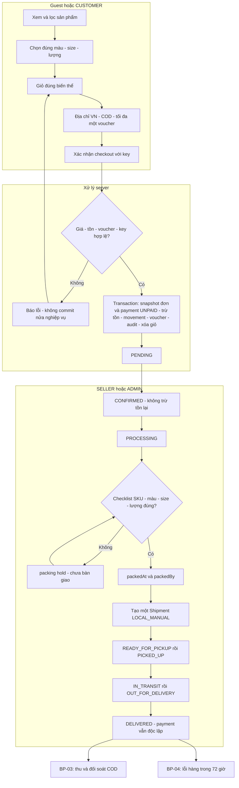
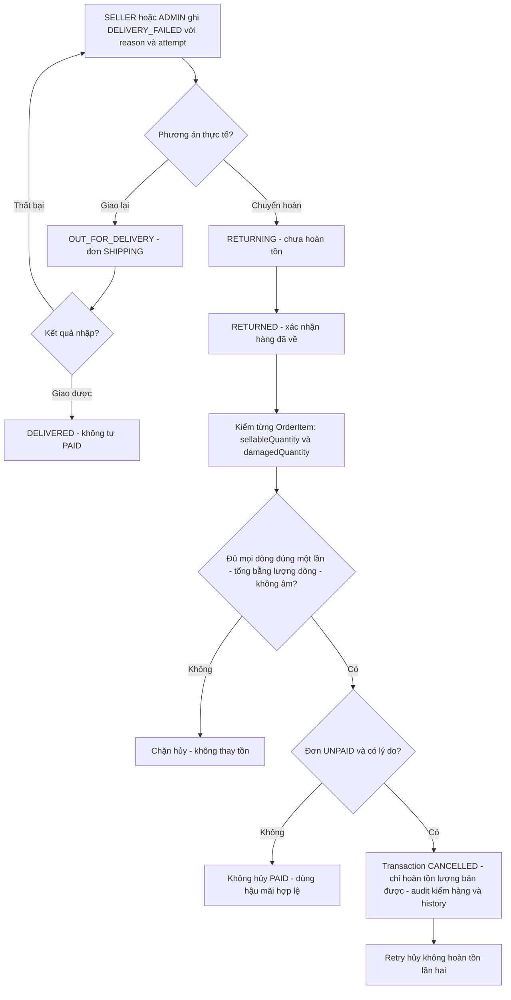
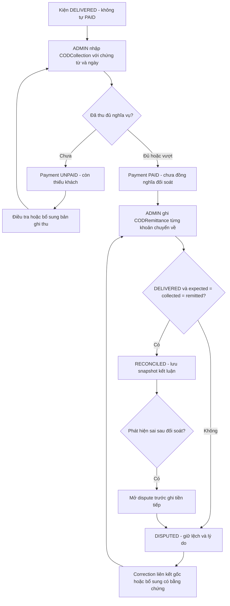
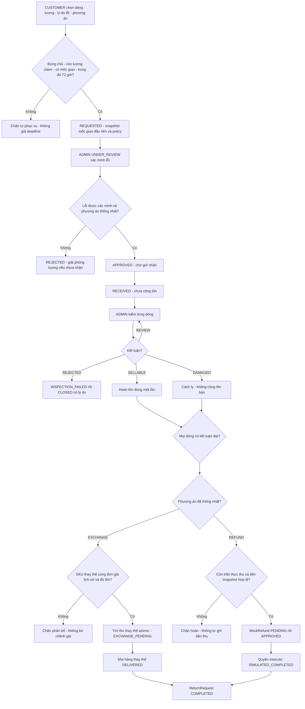
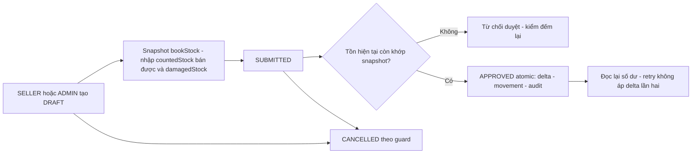

# Quy trình nghiệp vụ

[BRD](business-requirements.md) · [Use cases](use-cases.md) · [Rules](business-rules.md) · [ERD](data-model.md)

Mermaid dưới đây mô tả **trình tự, quyết định và người chịu trách nhiệm**, không phải bằng chứng các bước đã chạy. Toàn bộ giao nhận/tiền là local/manual/mô phỏng. Tên trạng thái trong sơ đồ là giá trị hiện hữu; hình thoi là quyết định, không phải enum mới.

## BP-01 — Từ lựa chọn hàng đến giao hàng

UC04–UC09, UC13–UC16, UC24; FR-003–FR-009; BR-008, BR-011–BR-018.

Cạnh tranh đơn vị tồn/lượt voucher cuối chỉ một transaction hợp lệ commit; retry cùng key/payload trả kết quả đã tạo, không chạy lại side effect. Chọn hàng/giỏ không tạo reservation. Mốc đóng gói không được bịa cho lịch sử cũ. [Máy trạng thái đơn](order-state-machine.md) và [kiện](shipping-state-machine.md) là chi tiết đầy đủ.

## BP-02 — Giao thất bại, hàng quay về và hủy

UC12, UC16, UC24; FR-007–FR-009, FR-011; BR-015, BR-016, BR-019.

Kiểm hàng chuyển hoàn là nghiệp vụ đơn chưa giao thành công, ghi dữ liệu kiểm trong audit vận hành và lịch sử trạng thái. **Không phải** ReturnInspection của khách trả hàng sau giao. Payload `returnedItems` chứa `{orderItemId, sellableQuantity, damagedQuantity}` cho đúng tất cả dòng; hàng hỏng không cộng vào tồn bán. Hủy bình thường trước bàn giao không yêu cầu kiểm chuyển hoàn và hoàn đúng tồn đã xuất. Hủy một phần vẫn bị khóa chính sách.

## BP-03 — Thu, chuyển về và đối soát COD

UC10, UC28; FR-010; BR-004, BR-020–BR-022.

Số dư `outstandingCOD = max(collectedCOD − remittedCOD, 0)`. Thu vượt, thu thiếu hoặc chuyển vượt không được che bằng ép số tổng. Correction là bản ghi mới có dấu, không sửa/xóa chứng từ gốc; tổng không âm và không làm vượt trần hoàn đã giữ/hoàn. Phí giao thực tế không tự khấu trừ COD. [Chi tiết COD](cod-reconciliation.md).

## BP-04 — Đổi trả lỗi và hoàn mô phỏng

UC26, UC27; FR-018, FR-019; BR-023–BR-027.

Deadline bao gồm đúng mốc `deliveredAt + 72 giờ`, không hết ngày lịch. Ảnh lỗi tùy chọn và riêng tư. Đổi/hoàn chỉ sau kết luận kiểm hàng theo guard; đơn/kiện gốc không đổi CANCELLED để xử lý hàng đã trả tiền. Kết quả cuối không ghi đè, retry không double stock/refund. S chỉ đọc hồ sơ hỗ trợ. [Return state machine](returns-state-machine.md) bổ sung các nhánh CLOSED và điều kiện cuối; [ledger](mock-refund-ledger.md) giải thích phân bổ tiền/phí giao.

## BP-05 — Kiểm kê kho

UC17, UC29; FR-011, FR-020; BR-028, BR-029.

Phiếu không cho ghi đè giao dịch bán/nhập/xuất mới. Hàng hỏng được ghi riêng, không cộng vào countedStock bán được. Trạng thái cuối không mở lại để thay lịch sử.

## Sơ đồ liên kết kỹ thuật

[Bản đồ nghiệp vụ → UI → service → bảng (SVG)](diagrams/business-processes.svg) / [PNG](diagrams/business-processes.png) / [Mermaid](diagrams/business-processes.mmd) là **mapping kiến trúc**, không phải trình tự workflow. [ERD logic và đầy đủ](data-model.md) giải thích các quan hệ thực. Sơ đồ mapping/ERD sinh bởi [exporter](../scripts/export-business-diagrams.ts); các quyết định nghiệp vụ ở tài liệu này cần được duy trì cùng rules và test khi chính sách đổi.
