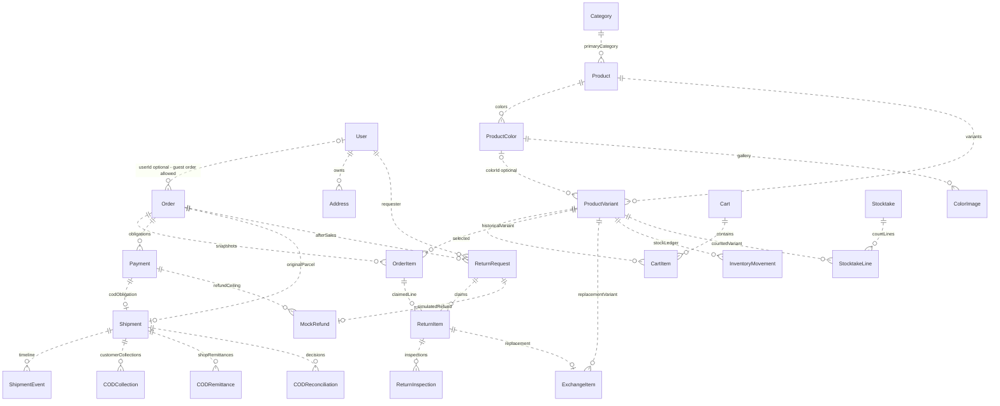

# Mô hình dữ liệu và ERD

[BRD](business-requirements.md) · [Quy trình](business-processes.md) · [Business rules](business-rules.md)

Nguồn chuẩn cấu trúc là [prisma/schema.prisma](../prisma/schema.prisma); [migrations](../prisma/migrations) bổ sung lịch sử thay đổi và constraint/trigger SQL không biểu diễn trong Prisma. Không dùng database riêng tư để vẽ sơ đồ. Các sơ đồ mô tả **cấu trúc**, không chứa bản ghi, tài khoản hay số liệu bán hàng.

## 1. ERD logic cho BA

Chỉ chọn trục kinh doanh chính, không phải toàn bộ bảng/cột. Cardinality lấy từ FK và unique trong schema. `||` = đúng một, `o|` = không hoặc một, `o{` = không hoặc nhiều. Quan hệ có nhiều con không đồng nghĩa phải có ít nhất một con: ví dụ schema cho phép Order chưa có item, nhưng service checkout bắt buộc giỏ hợp lệ.



Bản Mermaid riêng: [business-overview.mmd](diagrams/business-overview.mmd). Quan hệ nét đứt là non-identifying: phần lớn bảng có ID riêng, FK không phải một phần PK. Sơ đồ bỏ nhánh wishlist/media/analytics/content để dễ đọc; xem atlas đầy đủ phía dưới, không suy ra chúng bị loại khỏi hệ thống.

## 2. ERD toàn bộ bảng và cách tái tạo

- [Mermaid đầy đủ mọi cột/PK/FK/unique](diagrams/sql-relationships.mmd).
- [SVG atlas khóa theo nhóm nghiệp vụ](diagrams/sql-relationships.svg), [PNG](diagrams/sql-relationships.png): mọi bảng và khóa; tham chiếu FK ghi nhóm đích, không vẽ cạnh chéo gây rối. Atlas chỉ tập trung khóa; Mermaid giữ toàn bộ cột.
- [Mapping nghiệp vụ → UI → backend → bảng](diagrams/business-processes.svg), [Mermaid](diagrams/business-processes.mmd).

Sau khi cài dependencies theo README, chạy tại root:

```sh
npx tsx scripts/export-business-diagrams.ts
```

Cần Node, dependencies project (Prisma CLI, tsx, sharp) và Python 3 với sqlite3 standard library. [Exporter](../scripts/export-business-diagrams.ts) dùng `prisma migrate diff --from-empty --to-schema-datamodel prisma/schema.prisma --script`, thực thi DDL vào SQLite **`:memory:`**, rồi introspect PK/FK/index. Giá trị `DATABASE_URL` được đặt riêng cho quá trình compile datamodel; không mở, tạo hoặc sửa DB của ứng dụng; không cần seed/credential/private `.env`. SVG/PNG do sharp tạo, không cần browser, Mermaid CLI hoặc dịch vụ ngoài. Chạy từ root vì đường dẫn input/output là relative.

**Giới hạn chính xác:** ERD được sinh từ datamodel hiện tại, không phải kiểm tra drift hoặc migration trên DB đang chạy. Trigger role chuẩn từ migration và kiểm nghiệp vụ service không nằm trong Mermaid; chỉ mục hiệu năng không duy nhất không được gắn nhãn UK. Cột legacy provider còn trong schema nhằm bảo toàn dữ liệu, không chứng minh có carrier integration đang hoạt động. Không mở database chính để “xác nhận” sơ đồ.

## 3. Từ điển thực thể theo nghiệp vụ

| Nhóm / thực thể | Ý nghĩa và dữ liệu quan trọng | Constraint / phân biệt cần đọc |
|---|---|---|
| User, Account, Session, PasswordReset, Address, ShopperPreference | Danh tính ba role, tài khoản liên kết, phiên hash/version/hạn dùng, reset một lần, địa chỉ và preference | User.email unique; Session.tokenHash unique; Account.providerAccountId unique. PasswordReset.email là snapshot string, không FK User. Email không có nghĩa mọi flow phải đăng ký bằng email; flow chỉ điện thoại vẫn theo service |
| Category, Collection, CollectionProduct | Cây ngành hàng và nhóm trưng bày | Category.parentId tự tham chiếu Restrict; slug unique. CollectionProduct PK ghép collectionId/productId, không tạo link trùng |
| Product, ProductVariant, ProductColor | Sản phẩm, SKU bán, màu có gallery; price/salePrice/override, stock, readiness tách active | Product.slug/sku unique; variant.sku unique và unique(productId,size,color); ProductColor unique(productId,name). colorId nullable giữ dữ liệu lịch sử, không tự xóa variant khi thiếu liên kết màu |
| ProductImage, ColorImage, MediaAsset, OutfitCombination, OutfitItem, SizeChart | Ảnh toàn hàng/đúng màu, nguồn asset, liên kết phối và bảng size JSON | Quan hệ chi tiết ở Mermaid đầy đủ. JSON phải validate ở service; FK không xác nhận quyền ảnh, hàng thật hoặc độ đúng bảng size |
| Cart, CartItem, Wishlist, WishlistItem | Giỏ user/guest và yêu thích | Cart.userId/guestToken unique nullable; CartItem unique(cartId,variantId), quantity được kiểm server. WishlistItem unique(wishlistId,productId) |
| Order, OrderItem, OrderStatusHistory | Snapshot thỏa thuận mua, dòng hàng, lịch sử xử lý; tổng VND, ba trạng thái và packing metadata | Order.code/accessToken/idempotencyKey unique; userId nullable. accessToken chỉ cấp capability cho đơn guest cũ userId=null, không thay phiên của đơn tài khoản. OrderItem giữ FK product/variant **và** snapshot tên/SKU/màu/size/ảnh/giá; không render đơn cũ bằng giá catalog mới |
| Payment | Nghĩa vụ thanh toán gốc của đơn, không phải mỗi lần thu/chuyển | orderId không unique: schema cho phép nhiều Payment/order; service checkout hiện tạo COD hợp lệ, shipment kiểm đúng payment. Không vẽ Order–Payment 1:1 sai với SQL |
| Coupon, CouponRedemption | Voucher hiện tại và bằng chứng dùng vào đơn | Coupon.code unique; redemption.orderId unique = tối đa một voucher/đơn; usageLimit/used và cửa sổ hiệu lực được kiểm atomic bởi service |
| Shipment, ShipmentEvent, DeliveryAttempt | Hồ sơ kiện gốc, event nhập local, các lần giao thất bại | Shipment.orderId/paymentId/reference đều unique; Shipment.version CAS. Mã nội bộ không phải vận đơn hãng; expectedCOD là snapshot, không sửa theo client |
| CODCollection, CODRemittance, CODReconciliation | Ba ledger/quyết định độc lập về thu khách, chuyển shop và đối soát | Collection/Remittance.eventKey unique và unique(provider,reference); correctsId tự FK Restrict. Reconciliation lưu snapshot số tiền; không xóa/sửa lịch sử để ép khớp |
| ReturnRequest, ReturnItem, ReturnEvidence, ReturnInspection, ReturnHistory | Hồ sơ lỗi sau giao, dòng claim/tiền phân bổ, ảnh riêng tư, nhiều lần kiểm và lịch sử | request.eventKey/reference unique, deadline/deliveredAt/policyVersion snapshot; ReturnItem unique(requestId,orderItemId). Tổng claim xuyên nhiều hồ sơ là guard transaction, không do unique này tự bảo đảm |
| ExchangeItem, MockRefund | SKU thay thế và khoản hoàn mô phỏng | ExchangeItem.itemId/reference unique, FK variant; MockRefund.requestId/reference unique, FK order/payment. Một refund/request không tự ngăn hoàn vượt thực thu xuyên nhiều request: service kiểm trần |
| InventoryMovement, Stocktake, StocktakeLine | Delta tồn và phiếu kiểm đếm so bookStock/count bán được/damaged | Movement.variantId FK; orderId/actorId chỉ string snapshot. Stocktake.eventKey unique; line unique(stocktakeId,variantId); chặn bookStock stale và âm tồn ở service |
| Inquiry, InquiryReply, ProductReview, ReviewReply | Hỗ trợ và đánh giá đã mua, phản hồi/kiểm duyệt | Inquiry.userId optional; replies có actor FK và eventKey unique; review unique(userId,orderId,productId). Đã giao/mua là rule service, không chỉ FK |
| VisitorSession, AnalyticsEvent, CartAnalyticsCycle, OrderAttribution, ProductCostHistory, OrderLineAnalytics | Event first-party, cohort giỏ, nguồn đơn và cost snapshot | Event.eventKey unique; attribution.orderId và lineAnalytics.orderItemId là PK/FK; unitCost nullable = chưa biết, không phải 0. AnalyticsEvent.productId không FK |
| AuditLog, StoreSetting, Banner, Newsletter, SyntheticBatch, SyntheticRecord | Audit snapshot, cấu hình/nội dung và provenance dữ liệu tổng hợp | AuditLog.actorId/targetId và SyntheticRecord.batchId/entity/recordId không FK theo schema; không tự vẽ cạnh. SyntheticRecord unique(entity,recordId). Newsletter.email unique không phải danh tính User |

## 4. Constraint SQL và bất biến service

| SQL/datamodel bảo đảm | Service/transaction cần bảo đảm thêm |
|---|---|
| PK, unique, FK, nullable, onDelete và index khai báo | Role hợp lệ/quyền/ownership/session version; trigger role trong migration là lớp bổ sung |
| Shipment duy nhất theo order/payment; ReturnItem không trùng trong cùng request | State transition, đóng gói, nhất quán Order–Shipment–Payment và một lần hoàn tồn |
| Event/reference duy nhất | Cùng key cùng payload là no-op; key khác payload bị chặn; audit cùng commit |
| Cột Int / DateTime / String | VND không âm, tránh overflow, tồn không âm, voucher/claim/refund không vượt giới hạn, 72 giờ chính xác |
| Nullable user/color/cost | Không suy diễn chủ đơn guest, không mượn ảnh khác màu, không bịa giá vốn |

**Chuyển hoàn trước giao thành công:** kiểm từng dòng `{orderItemId, sellableQuantity, damagedQuantity}` trước `RETURNED→CANCELLED`, lưu trong audit vận hành/lịch sử; không tạo ReturnRequest/ReturnInspection của khách. Chỉ phần bán được tạo movement hoàn tồn, phần hỏng không cộng tồn bán. Đây là quy tắc service/audit, không thêm quan hệ SQL giả.

## 5. Snapshot, xóa và riêng tư

- Danh mục/sản phẩm/hồ sơ hiện tại có thể thay đổi; đơn, giá mua, mốc deadline return và chứng từ phải giữ nghĩa lịch sử. Active/readiness và ẩn/xóa có reference guard thay cho xóa phá ledger.
- Nhiều FK tài chính/return dùng Restrict; một số cấu trúc phụ như ảnh/địa chỉ có Cascade/SetNull theo schema. **Không** diễn giải Cascade là cho phép xóa đơn/hàng đã có nghiệp vụ; guard cấp ứng dụng vẫn cần.
- Chỉ ID/cột/quan hệ xuất hiện trong sơ đồ. Không xuất bản token/hash giá trị, địa chỉ khách, bằng chứng base64, audit payload, private DB hoặc backup. Mọi ví dụ chạy/test dùng dữ liệu tổng hợp riêng.
