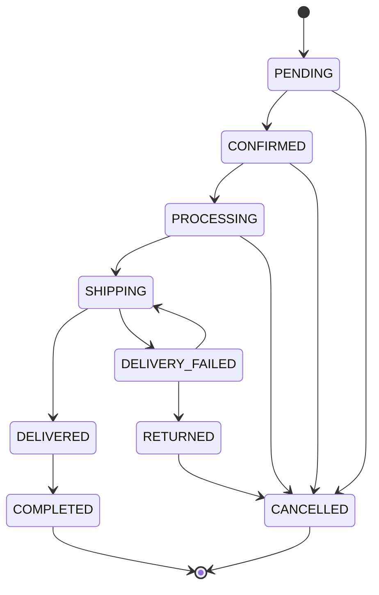

# Máy trạng thái đơn hàng

## Trạng thái đơn

- Giữ nguyên tất cả tên trạng thái cũ; chỉ thêm DELIVERY_FAILED và RETURNED (cột string, không sửa enum).
- Khách (đăng nhập sở hữu đơn hoặc có cookie capability của đơn khách) chỉ hủy PENDING/CONFIRMED và UNPAID. Đây là yêu cầu được xử lý ngay khi đủ điều kiện, không có hàng đợi duyệt giả.
- Admin hủy thêm PROCESSING hoặc RETURNED, chỉ khi UNPAID. Giao thất bại chưa trả tồn; cần ghi nhận hàng quay về rồi mới hủy.
- Lặp CANCELLED → CANCELLED là no-op idempotent, không phải cạnh hợp lệ mới; không thêm history/stock/coupon lần hai.
- Mọi cạnh khác bị từ chối. Bắt buộc reason cho hủy, bàn giao, kết quả giao và hàng quay về.

## Ba trạng thái độc lập
- Order.status: tiến trình xử lý.
- Order.shippingStatus: NOT_DISPATCHED, IN_TRANSIT, DELIVERED, FAILED, RETURNED. Chỉ cập nhật qua sự kiện giao nhận thủ công, không giả kết nối hãng.
- Order.paymentStatus và Payment.status: UNPAID/PAID ở nghiệp vụ. Giao thành công hay hoàn tất vẫn có thể UNPAID.
- COD_COLLECTED là sự kiện riêng, không chuyển order.status. Chỉ ADMIN, sau DELIVERED/COMPLETED, có reason + mã chứng từ. Ghi actor/time/amount/currency và audit trong cùng transaction. Lặp sau PAID là no-op.

## Tương thích dữ liệu
Migration `20261018110000_order_lifecycle` chỉ ALTER ADD COLUMN và suy ra shippingStatus từ trạng thái cũ. Không đổi tên/xóa bảng hay xóa record. History cũ giữ nguyên, trường actor/previousStatus nullable; không bịa chứng từ COD hay lịch sử cũ. Các bản ghi PAID trước migration không được giả thêm bằng chứng thu tiền.

## Guard đóng gói bổ sung ngày 20/10/2026

Giữ enum PROCESSING để tương thích lịch sử. Đã đóng gói được ghi bằng packedAt/packedBy và audit checklist đúng từng dòng SKU, màu, size, số lượng. Không tạo shipment mới hoặc chuyển sang SHIPPING khi thiếu packedAt hoặc đang có packingHoldReason. Đơn đang vận chuyển từ trước không bị giả thêm mốc đóng gói. Phân công và priority không thay trạng thái, tiền hoặc tồn. Tiêu chuẩn hiện hành: [31 nghiệp vụ HÀ NHI](business-acceptance-31.md).

Hủy một phần đang khóa ở database chính, chờ chính sách tài chính được phê duyệt; không phải một cạnh chuyển trạng thái công khai. Quy tắc hủy toàn bộ, đổi trả lỗi đủ 72 giờ và COD không tự ghi PAID từ giao hàng được giữ nguyên.
