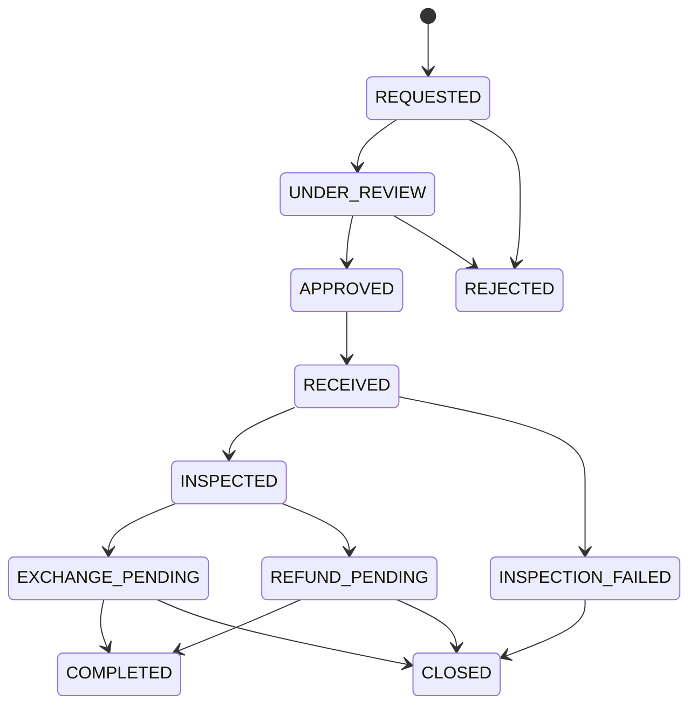

# Máy trạng thái đổi trả — Phase 3

APPROVED đồng thời biểu thị đang chờ gửi/nhận hàng; không thêm AWAITING_RETURN riêng. RECEIVED đồng thời chờ kiểm hàng; REVIEW ở từng dòng không tự chuyển state. INSPECTED chỉ được service kiểm hàng thiết lập sau kết luận SELLABLE/DAMAGED của mọi dòng. Có dòng REJECTED → INSPECTION_FAILED, chỉ cho đóng với lý do.

EXCHANGE_PENDING chỉ do phân bổ đủ SKU thành công. COMPLETED chỉ khi mọi kiện hàng thay thế DELIVERED hoặc refund SIMULATED_COMPLETED. REFUND_PENDING → CLOSED chỉ khi khoản hoàn bị REJECTED/CANCELED. Đóng hồ sơ exchange chỉ khi mọi kiện đã RETURNED/CANCELED, không đóng để bỏ kiện đang giao.

REJECTED/COMPLETED/CLOSED là kết thúc. Không mở lại/xóa lịch sử. Gọi lại state hiện có là no-op, không thêm cạnh chuyển trạng thái tùy ý. Mỗi chuyển đổi lưu previousStatus/status/actor/createdAt/reason/request; order liên kết qua request. Event kiện thay thế ghi from/to riêng trong lý do lịch sử cùng audit có cấu trúc. Inspection và ledger không cho endpoint state chung bỏ qua.

Giữ nguyên toàn bộ máy trạng thái đơn và Shipment Phase 1/2A. ReturnRequest là trục nghiệp vụ sau bán, không đổi Order.status thành CANCELLED hoặc thay OrderItem.
