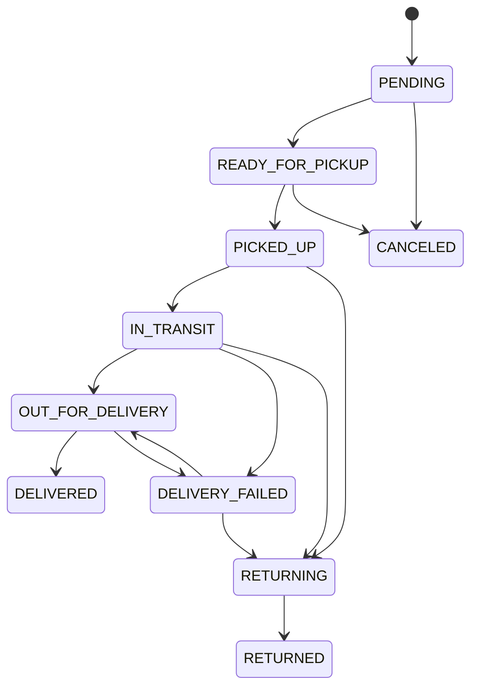

# Trạng thái giao nhận

DELIVERED, RETURNED, CANCELED là kết thúc cho kiện này. Không tạo kiện thứ hai cho cùng đơn ở nghiệp vụ.

| Sự kiện kiện | Đồng bộ trạng thái đơn |
|---|---|
| PENDING/READY_FOR_PICKUP | Giữ PROCESSING |
| PICKED_UP | PROCESSING → SHIPPING |
| IN_TRANSIT/OUT_FOR_DELIVERY | Giữ SHIPPING; khi giao lại từ DELIVERY_FAILED → SHIPPING |
| DELIVERY_FAILED | SHIPPING → DELIVERY_FAILED; lưu DeliveryAttempt |
| RETURNING | Nếu đơn còn SHIPPING, ghi DELIVERY_FAILED; không hoàn tồn |
| RETURNED | DELIVERY_FAILED → RETURNED; không hoàn tồn |
| CANCELED trước bàn giao | PROCESSING → CANCELLED, hoàn tồn theo nghiệp vụ |
| DELIVERED | SHIPPING → DELIVERED; không tự thanh toán |

Khi RETURNED, SELLER/ADMIN kiểm đủ từng OrderItem trước hủy UNPAID: `returnedItems` ghi `sellableQuantity` và `damagedQuantity` nguyên không âm, tổng bằng lượng dòng, không thiếu/trùng/sai dòng. CAS hủy chỉ hoàn tồn lượng bán được đúng một lần; lượng hỏng không vào tồn bán. Phân loại giữ trong audit/lịch sử vận hành, không phải ReturnInspection khách trả sau giao. Giao thất bại cần reasonCode và note. Các lý do: không liên hệ được, từ chối nhận, địa chỉ sai, giao không thành công. Mọi cập nhật lưu previousStatus/status/createdAt/actorId/source=LOCAL_MANUAL; không nhận source từ client.

Đơn cũ chưa có Shipment vẫn dùng quy trình nghiệp vụ. Đơn đã có Shipment bị chặn các chuyển giao/thu COD ở endpoint cũ, buộc đi qua hồ sơ để hai trạng thái thống nhất. Cập nhật đơn và kiện cùng transaction, rollback nếu một phía không hợp lệ.
